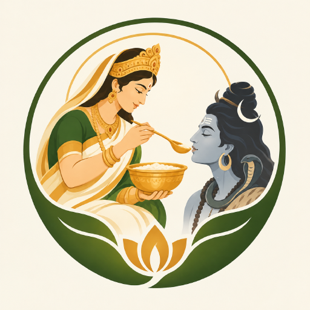

<p align="center">
  
</p>

<h1 align="center">ANNPURNN · અન્નપૂર્ણ</h1>

<p align="center"><b>अन्न ब्रह्म है |</b> · અન્ન બ્રહ્મ છે | · Food is divine</p>

**Share food, share dignity.** A community food-sharing platform for Surat, Gujarat — connecting people with surplus food to people who need it. Food is always free. Food seekers' dignity, privacy and safety come first.

- 📱 Mobile-first web app (Android-ready: the app consumes the same REST API)
- 🌐 English · ગુજરાતી · हिन्दी
- 🔒 Privacy by design: no public names, faces, phones or addresses; no poverty proof
- 💬 Community chat room where donors, seekers and helpers can talk (moderated)
- 💚 Free forever — no ads, no sponsored sections, no charges

## Quick start

```bash
npm test          # run the 22-test API suite
npm run seed      # demo data + admin account
npm start         # http://localhost:3000  (app)  /admin  (dashboard)
```

Requires Node ≥ 22.13. Zero npm dependencies.

Seeded logins (OTP is printed to the console in dev mode): admin `+919800000009`, donor `+919800000002`, seeker `+919800000001`, helper `+919800000004`.

## Features

| | |
|---|---|
| **Request Food** | Food, #people, veg/non-veg, area, time, urgency/accessibility notes, pickup/delivery, status machine (open → accepted → ready → completed/cancelled) |
| **Donor accepts** | Race-safe accept, secure in-app chat, exact address shared only after acceptance, two-sided completion confirmation, multiple-donor option |
| **Request for someone** | Verified community helpers request on behalf of elderly/homeless/disabled/offline people — anonymous by default, photo optional + consent-gated, “Created by a community helper” label |
| **Donor feed** | Two tabs (seekers / helper-created), filters by area, preference, people, time; report suspicious requests |
| **Donate Food** | Full listing with allergens, storage, safe deadline; automatic food-safety screening + admin review before visibility; claim/approve matching |
| **Trust & safety** | Phone OTP, donor & helper verification, reporting, blocking, rate limits, duplicate detection, complaints queue, audit log, analytics |
| **Admin dashboard** | Users, verification, requests, donation safety review, complaints, community chat moderation, audit log, KPIs |
| **Community chat** | One open, moderated chat room for donors, seekers and helpers to coordinate and talk |

## Documentation

| Doc | Contents |
|---|---|
| [docs/ARCHITECTURE.md](docs/ARCHITECTURE.md) | MVP architecture, privacy model, module map, scaling path |
| [docs/USER_JOURNEYS.md](docs/USER_JOURNEYS.md) | Journey diagrams for all four roles |
| [docs/SCREENS.md](docs/SCREENS.md) | Complete screen list & navigation |
| [docs/API.md](docs/API.md) | All endpoints + permission matrix |
| [docs/SECURITY_PRIVACY.md](docs/SECURITY_PRIVACY.md) | Auth, RBAC, privacy rules → code, abuse prevention, DPDP/FSSAI notes |
| [docs/FOOD_SAFETY.md](docs/FOOD_SAFETY.md) | Safety screening, review workflow, launch checklist |
| [docs/TESTING.md](docs/TESTING.md) | Automated suite + manual test plan (fraud, privacy, duplicates) |
| [docs/DEPLOYMENT.md](docs/DEPLOYMENT.md) | Local, VPS, TLS, hardening, Android path |

## Legal & safety notice

ANNPURNN is a connection platform and **does not guarantee food safety**; donors are responsible for the food they share. Food requests and collections are always free — never pay anyone for donated food. Before public launch, complete the FSSAI/DPDP compliance checklist in `docs/FOOD_SAFETY.md` and `docs/SECURITY_PRIVACY.md`.

## License
MIT
